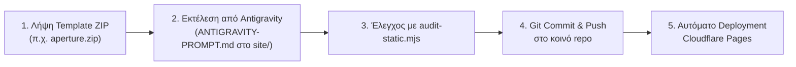

# ΕΠΑΝΑΧΡΗΣΙΜΟΠΟΙΗΣΙΜΟ WORKFLOW ΑΥΤΟΜΑΤΗΣ ΔΗΜΟΣΙΕΥΣΗΣ
## VGES-9-WEBSITES (GITHUB & CLOUDFLARE PAGES)

Αυτός ο οδηγός περιγράφει τη βήμα-προς-βήμα διαδικασία για την ταχύτατη μετατροπή κάθε νέου template ZIP σε έτοιμο demo website και την αυτόματη δημοσίευσή του.

---

### ΡΟΗ ΓΙΑ ΚΑΘΕ ΝΕΟ PROJECT (03 ΕΩΣ 09)



#### Βήμα 1: Λήψη Template ZIP
1. Κατεβάζετε το επίσημο δωρεάν ZIP από το uiCookies:
   * **03 Fos Photography:** [Aperture](https://uicookies.com/downloads/aperture/)
   * **04 Nisa Beauty:** [Serene](https://uicookies.com/downloads/serene/)
   * **05 Areti Medical:** [Vitals](https://uicookies.com/downloads/vitals/)
   * **06 Lumen Dental:** [Pearl](https://uicookies.com/downloads/pearl/)
   * **07 Themis Legal:** [Counsel](https://uicookies.com/downloads/counsel/)
   * **08 Axia Accounting:** [Summit](https://uicookies.com/downloads/summit/)
   * **09 Pedia Learning Center:** [Enlight](https://uicookies.com/downloads/enlight-free-education-responsive-bootstrap-website-template/)
2. Τοποθετείτε το αρχείο ZIP στον φάκελο `Downloads` ή απευθείας στο workspace.

#### Βήμα 2: Αυτόνομη Προσαρμογή από το Antigravity
1. Το Antigravity αποσυμπιέζει τα αρχεία αποκλειστικά στον υποφάκελο `<project-folder>/site/`.
2. Εφαρμόζει πλήρως τις οδηγίες του `<project-folder>/ANTIGRAVITY-PROMPT.md`.
3. Προσαρμόζει ελληνικά κείμενα, SEO (`noindex, follow`), χρωματική παλέτα, responsive fluid typography, προσβάσιμο lightbox και demo φόρμα.
4. Δημιουργεί ιδιόκτητο `favicon.svg` και ενημερώνει το `ASSET-CREDITS.md`.

#### Βήμα 3: Δομικός Έλεγχος Ποιότητας (QA)
Εκτέλεση του τοπικού smoke test:
```bash
node tools/audit-static.mjs <project-folder>/site
```
Επιβεβαίωση μηδενικών σπασμένων links (0 missing assets, 0 broken anchors, 0 404s).

#### Βήμα 4: Git Commit & Push
Το Antigravity κάνει αυτόματα commit και push στο κοινό GitHub repository:
```bash
git add .
git commit -m "feat(project): complete <project-name> demo website"
git push origin main
```

#### Βήμα 5: Αυτόματη Δημοσίευση (Cloudflare Pages)
Εφόσον το project έχει συνδεθεί μία φορά στο Cloudflare Pages με **Root directory: `<project-folder>/site`**, η Cloudflare ανιχνεύει το push και δημοσιεύει τη νέα έκδοση μέσα σε 10-15 δευτερόλεπτα.

---

### ΣΥΝΟΠΤΙΚΟΣ ΠΙΝΑΚΑΣ ΡΥΘΜΙΣΕΩΝ CLOUDFLARE PAGES

| Cloudflare Project Name | Συνδεδεμένο Repo | Root Directory | Framework Preset | Build Command | Output Directory | Δημόσιο URL |
|---|---|---|---|---|---|---|
| `vges-aurelio` | `VGES-9-Websites` | `01-Aurelio-Barbershop/site` | None | *(κενό)* | *(κενό)* | `https://vges-aurelio.pages.dev` |
| `vges-mason-elia` | `VGES-9-Websites` | `02-Mason-Elia/site` | None | *(κενό)* | *(κενό)* | `https://vges-mason-elia.pages.dev` |
| `vges-fos-photography` | `VGES-9-Websites` | `03-Fos-Photography/site` | None | *(κενό)* | *(κενό)* | `https://vges-fos-photography.pages.dev` |
| `vges-nisa-beauty` | `VGES-9-Websites` | `04-Nisa-Beauty/site` | None | *(κενό)* | *(κενό)* | `https://vges-nisa-beauty.pages.dev` |
| `vges-areti-medical` | `VGES-9-Websites` | `05-Areti-Medical/site` | None | *(κενό)* | *(κενό)* | `https://vges-areti-medical.pages.dev` |
| `vges-lumen-dental` | `VGES-9-Websites` | `06-Lumen-Dental/site` | None | *(κενό)* | *(κενό)* | `https://vges-lumen-dental.pages.dev` |
| `vges-themis-legal` | `VGES-9-Websites` | `07-Themis-Legal/site` | None | *(κενό)* | *(κενό)* | `https://vges-themis-legal.pages.dev` |
| `vges-axia-accounting` | `VGES-9-Websites` | `08-Axia-Accounting/site` | None | *(κενό)* | *(κενό)* | `https://vges-axia-accounting.pages.dev` |
| `vges-pedia-learning` | `VGES-9-Websites` | `09-Pedia-Learning-Center/site` | None | *(κενό)* | *(κενό)* | `https://vges-pedia-learning.pages.dev` |
