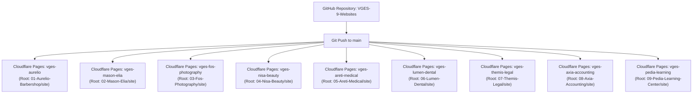

# VGES ONLINE WEBSITES — MASTER PROJECTS DIRECTORY

Κεντρικό ευρετήριο διαχείρισης, τεκμηρίωσης, παρακολούθησης και στρατηγικής αυτοματοποιημένης δημοσίευσης (GitHub & Cloudflare Pages) για τα 9 ανεξάρτητα demo websites του **VGES Online Websites**.

---

## 1. Συγκεντρωτικός Πίνακας Έργων & Κατάσταση

| # | Project | Φάκελος Έργου | Static Publish Directory | Επιλεγμένο uiCookies Template | Live Demo Template | Επίσημο Download | Κατάσταση Ανάπτυξης | Cloudflare Pages Deployment Target |
|---|---|---|---|---|---|---|---|---|
| **01** | **Aurelio Barbershop** | `01-Aurelio-Barbershop/` | `01-Aurelio-Barbershop/site` | [Fade](https://uicookies.com/downloads/fade/) | [Demo](https://uicookies.com/demo/theme/fade/) | [Official Page](https://uicookies.com/downloads/fade/) | 🟢 **Πλήρως Υλοποιημένο & Έτοιμο** | `vges-aurelio.pages.dev` |
| **02** | **Mason Elia** | `02-Mason-Elia/` | `02-Mason-Elia/site` | [Gusto](https://uicookies.com/downloads/gusto/) | [Demo](https://uicookies.com/demo/theme/gusto/) | [Official Page](https://uicookies.com/downloads/gusto/) | 🟢 **Πλήρως Υλοποιημένο & Έτοιμο** | `vges-mason-elia.pages.dev` |
| **03** | **Fos Photography** | `03-Fos-Photography/` | `03-Fos-Photography/site` | [Aperture](https://uicookies.com/downloads/aperture/) | [Demo](https://uicookies.com/demo/theme/aperture/) | [Official Page](https://uicookies.com/downloads/aperture/) | 🔴 **Εκκρεμεί Template (Aperture ZIP)** | `vges-fos-photography.pages.dev` |
| **04** | **Nisa Beauty** | `04-Nisa-Beauty/` | `04-Nisa-Beauty/site` | [Serene](https://uicookies.com/downloads/serene/) | [Demo](https://uicookies.com/demo/theme/serene/) | [Official Page](https://uicookies.com/downloads/serene/) | 🔴 **Εκκρεμεί Template (Serene ZIP)** | `vges-nisa-beauty.pages.dev` |
| **05** | **Areti Medical** | `05-Areti-Medical/` | `05-Areti-Medical/site` | [Vitals](https://uicookies.com/downloads/vitals/) | [Demo](https://uicookies.com/demo/theme/vitals/) | [Official Page](https://uicookies.com/downloads/vitals/) | 🔴 **Εκκρεμεί Template (Vitals ZIP)** | `vges-areti-medical.pages.dev` |
| **06** | **Lumen Dental** | `06-Lumen-Dental/` | `06-Lumen-Dental/site` | [Pearl](https://uicookies.com/downloads/pearl/) | [Demo](https://uicookies.com/demo/theme/pearl/) | [Official Page](https://uicookies.com/downloads/pearl/) | 🔴 **Εκκρεμεί Template (Pearl ZIP)** | `vges-lumen-dental.pages.dev` |
| **07** | **Themis Legal** | `07-Themis-Legal/` | `07-Themis-Legal/site` | [Counsel](https://uicookies.com/downloads/counsel/) | [Demo](https://uicookies.com/demo/theme/counsel/) | [Official Page](https://uicookies.com/downloads/counsel/) | 🔴 **Εκκρεμεί Template (Counsel ZIP)** | `vges-themis-legal.pages.dev` |
| **08** | **Axia Accounting** | `08-Axia-Accounting/` | `08-Axia-Accounting/site` | [Summit](https://uicookies.com/downloads/summit/) | [Demo](https://uicookies.com/demo/theme/summit/) | [Official Page](https://uicookies.com/downloads/summit/) | 🔴 **Εκκρεμεί Template (Summit ZIP)** | `vges-axia-accounting.pages.dev` |
| **09** | **Pedia Learning Center** | `09-Pedia-Learning-Center/` | `09-Pedia-Learning-Center/site` | [Enlight](https://uicookies.com/downloads/enlight-free-education-responsive-bootstrap-website-template/) | [Demo](https://uicookies.com/demo/theme/enlight/) | [Official Page](https://uicookies.com/downloads/enlight-free-education-responsive-bootstrap-website-template/) | 🔴 **Εκκρεμεί Template (Enlight ZIP)** | `vges-pedia-learning.pages.dev` |

---

## 2. Αναλυτικά Στοιχεία Έργων

### 01. Aurelio Barbershop
* **Κλάδος:** Premium Classic Barber House / Ανδρική Περιποίηση
* **Template:** uiCookies Fade
* **Αισθητική:** Σκούρο, industrial vintage, gold/amber accents, αυθεντικότητα, craftsmanship.
* **Κατάσταση Ανάπτυξης:** 🟢 **Ολοκληρωμένο & Έτοιμο**
  - **Πλήρης δομή 2 σελίδων:** `index.html` (Hero, Υπηρεσίες, Barber crew, Gallery κουρεμάτων με φίλτρα, Demo κράτηση, E-shop grooming showcase, Ωράριο/Χάρτης) και `about.html` (Η ιστορία, η ομάδα και οι αξίες).
  - **Assets & Credits:** Πλήρης συλλογή φωτογραφιών κουρεμάτων, πορτρέτων και προϊόντων. Δημιουργήθηκε ιδιόκτητο `favicon.svg` με μονόγραμμα AB και προστέθηκε `ASSET-CREDITS.md`.
  - **SEO & Έλεγχος:** Ενσωματώθηκε `<meta name="robots" content="noindex, follow">`, 0 missing assets σε έλεγχο 80+ στοιχείων.
  - **Cloudflare Ready:** Static Publish Directory: `01-Aurelio-Barbershop/site`.

### 02. Mason Elia Gastrobar
* **Κλάδος:** Fine Dining / Μεσογειακή Γαστρονομία & Cocktail Bar
* **Template:** uiCookies Gusto
* **Αισθητική:** Minimal πολυτέλεια, ζεστοί γήινοι τόνοι, spruce green (#172B25), brass (#E8A13C), terracotta (#B44C32), bone (#F3EBDD).
* **Κατάσταση Ανάπτυξης:** 🟢 **Ολοκληρωμένο & Έτοιμο**
  - **Ελληνικό περιεχόμενο:** Πλήρης ενσωμάτωση όλων των ενοτήτων του ANTIGRAVITY-PROMPT.md.
  - **Δομή ενοτήτων:** `#top` (Hero), `#about` (Η ιδέα), `#menu` (Ενδεικτικός κατάλογος 4 κατηγοριών με τα 6 πιάτα), `#signature` (Sharing & Evening ambience), `#gallery` (6 εικόνες με accessible lightbox), `#faq` (3 διευκρινιστικές ερωτήσεις), `#contact` (Demo form χωρίς backend), Footer (αποποίηση ευθύνης, credits, metadata).
  - **Εικόνες & Assets:** Αποκατάσταση θεματικών φωτογραφιών (νέο atmospheric dining hero, αυθεντικό table setting about, dessert σοκολάτας & ελαιόλαδου, 6 gallery πιάτων/οίνου, τοπικό SVG favicon ME). Πλήρες μητρώο στο `ASSET-CREDITS.md`.
  - **Τεχνικός έλεγχος:** HTTP server test 15/15 passed (Status 200), zero 404s, 100% έγκυροι εσωτερικοί σύνδεσμοι, zero console errors, client-side demo validation.
  - **Cloudflare Ready:** Static Publish Directory: `02-Mason-Elia/site`.

### 03. Fos Photography
* **Κλάδος:** Editorial, Wedding & Portrait Photography Studio
* **Template:** uiCookies Aperture
* **Κατάσταση:** 🔴 **Εκκρεμεί το αρχείο `aperture.zip`**. Brief, prompt και εργαλείο QA (`tools/audit-static.mjs`) είναι πλήρως προετοιμασμένα.

### 04–09. Nisa Beauty, Areti Medical, Lumen Dental, Themis Legal, Axia Accounting, Pedia Learning Center
* **Κατάσταση:** 🔴 **Εκκρεμούν τα αντίστοιχα επίσημα template ZIPs από το uiCookies**.
  - Όλα τα briefs (`PROJECT-BRIEF.md`), prompts (`ANTIGRAVITY-PROMPT.md`), checklists (`ASSET-CHECKLIST.md`, `DEPLOYMENT-CHECKLIST.md`) και έρευνες (`TEMPLATE-RESEARCH.md`) βρίσκονται ήδη οργανωμένα μέσα σε κάθε φάκελο.

---

## 3. Αρχιτεκτονική Αυτοματοποίησης (GitHub & Cloudflare Pages)

Η προτεινόμενη αρχιτεκτονική βασίζεται σε **1 Κοινό Repository (Monorepo)** στο GitHub με **9 Ανεξάρτητα Cloudflare Pages Projects**:

### Πλεονεκτήματα Μοντέλου:
1. **Μηδενικό Build Step:** Κάθε site είναι καθαρό static HTML/CSS/JS (`Build Command: (κενό)`), άρα το deployment διαρκεί κάτω από 15 δευτερόλεπτα.
2. **Path Filtering / Root Directory:** Κάθε project στο Cloudflare Pages παρακολουθεί αποκλειστικά τον δικό του υποφάκελο `site/`. Αλλαγές στο Mason Elia ενεργοποιούν build ΜΟΝΟ για το `vges-mason-elia`!
3. **Αυτόνομο Domain:** Κάθε demo έχει δικό του ανεξάρτητο `pages.dev` URL (π.χ. `https://vges-aurelio.pages.dev`, `https://vges-mason-elia.pages.dev`).
4. **Απόλυτη Ασφάλεια:** Καμία αλλαγή ή επιρροή στο κεντρικό Studio ή στο ήδη δημοσιευμένο portfolio `vgesonline.pages.dev`.
